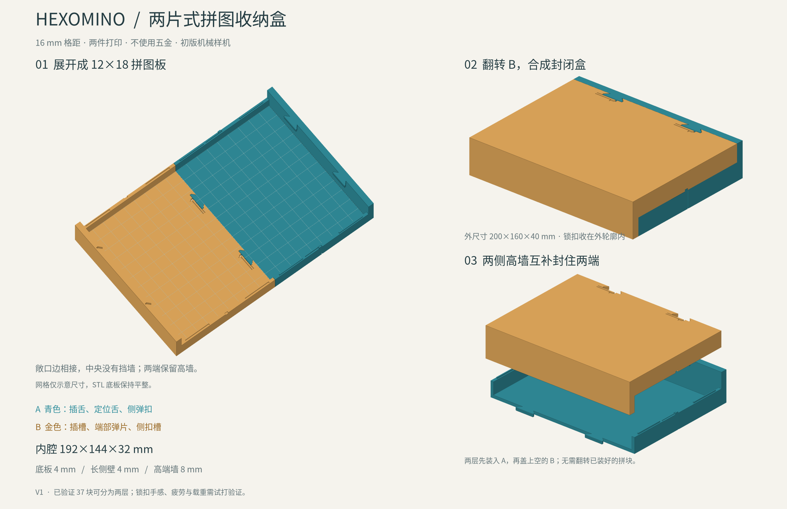
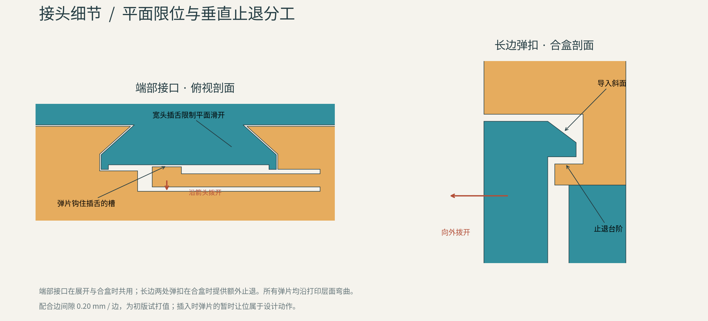
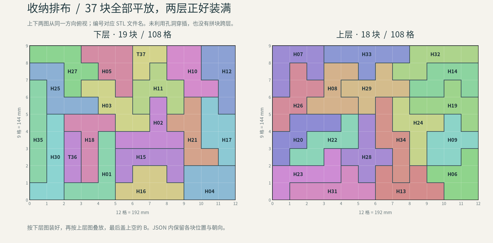

# 两片式拼图收纳盒 V1

2026-10-23。按单格 16 mm、内部有效空间 12×9×2 格设计。最终装配只使用 A、B 两个打印件，不需要五金。当前是可试打的机械初版；锁扣手感、疲劳寿命和满载携带强度尚需实物验证。



## 两片的形状

每片都是一只三边围住的托盘：两条长边是矮墙，一条短边是高墙，另一条短边敞开。A、B 的主体形状相同，连接结构不同。

- **A**：敞口底板有两只宽头插舌，高端墙上有对应的倒置插舌；长边带定位舌和两只向外释放的弹扣。
- **B**：敞口底板有两组插槽和弹片；高端墙有让位槽；长边有定位槽和侧扣槽。

展开时，B 在水平面内旋转 180°，与 A 的敞口边相接。两块底板齐平，中央没有挡墙，形成 12×18 格的连续拼图区。为了合盒，两端高墙保留，允许其高于长侧壁。

合盒时，将 B 翻面，使它的高端墙正对 A 的敞口，再盖在 A 上。两片高端墙分别封住盒子的两个短边，长边矮墙上下相接。两块底板成为盒底和盒盖。

盒子六个面的大面平整，锁扣收在外包尺寸内。接头处保留配合缝和弹片拨动槽。图中的格线用于说明尺寸，STL 底板没有刻格线。

## 尺寸

| 项目 | 尺寸 |
| --- | --- |
| 合盒内部有效空间 | 192×144×32 mm |
| 合盒外包尺寸 | 200×160×40 mm |
| 展开拼图有效区域 | 192×288 mm，即 12×18 格 |
| 展开外包尺寸 | 200×304×40 mm |
| 单件 A 的打印外包 | 200×158×40 mm，含伸出的底板插舌 |
| 单件 B 的打印外包 | 200×151.9×40 mm |
| 底板厚度 | 4 mm |
| 长侧壁厚度 | 4 mm |
| 高端墙厚度 | 8 mm，容纳接头 |
| 长侧壁在底板以上的高度 | 16 mm；A 的定位舌另高 1.5 mm，侧扣局部另高 1.8 mm |
| 高端墙在底板以上的高度 | 36 mm |

4 mm 底板和长侧壁作为首版试打厚度；高端墙保留 8 mm 以容纳 6 mm 深的接头。进一步减薄应在满载拿取、底板挠曲和锁扣拉脱试验后决定。

内腔按名义格距保持完整。现有打印拼块各表面的 0.10 mm 余量继续有效，不再重复扩大拼块或额外扣减内腔。

## 连接与操作



**拼图板状态**：A 的两只宽头插舌从上方压入 B 的插槽。宽头轮廓限制两片在板面内滑开，B 的弹片钩住插舌凹槽，限制上下拔出。不能像普通直榫一样直接平推插入。解除时，将 B 弹片向远离接缝的方向拨开，再逐端轻抬分离。

**盒子状态**：A 高端墙上的倒置插舌进入同一组 B 底板插槽。另一端，A 底板插舌进入 B 高端墙的让位槽。两条长边的定位舌对齐上下壁面；A 的两只长边弹扣进入 B 的槽，补充远离端部接口处的止退。

合盒时对准定位结构，均匀压下 B，使端部和两侧弹扣分别扣合。开盒时先将两侧弹扣向外拨开，再拨开 B 外表面的两处端部弹片，逐端轻抬。A 高墙上的插舌只用于盒子状态，A 底板插舌只在拼图板状态使用弹片锁定。

宽头插槽和长边定位槽按单边 0.20 mm 放宽；侧扣槽也保留约 0.20 mm 的对应让位。承靠面在名义位置接触，止退钩另有咬合量。这个参数是试打起点，不能据此保证任意打印机的松紧程度。

弹片的长轴都在打印床平面内，工作时沿层面弯曲。设计依据可参阅 [Formlabs 卡扣外壳设计说明](https://formlabs.com/blog/designing-3d-printed-snap-fit-enclosures/)；配合精度需按实际打印机和材料验证，见 [Prusa 的打印建模说明](https://help.prusa3d.com/article/modeling-with-3d-printing-in-mind_164135)。

## 装入全部 37 个拼块



已用现有求解器找到并验证两层完整排布：下层 19 块、上层 18 块，各占 108 格，合计 216 格。所有拼块都平放，没有拼块跨层，没有利用孔洞交错插入。

先将下层按图装入 A，再将上层直接叠在下层上方，最后盖上空的 B。两张排布图都从 A 的同一方向俯视，合盖前不翻转装有拼块的托盘。

位置和朝向保存在 `packing_12x9x2.json`。这是 12×9×2 的收纳排布，尺寸不同于网页默认的 18×12×1 平面棋盘。

## 打印与验证

两件都按 STL 当前姿态打印，底板外表面朝下，最高处为 40 mm。A 高端墙内侧的悬空插舌需要局部支撑；切片时应将支撑限制在这两处，避免填入弹片让位缝。移除支撑后先检查插舌凹槽是否干净。

正式打印两大件前，建议在切片软件中截取接头区域试打，确认 0.20 mm 配合、弹片释放和止退动作。完成整件后，先试空盒反复开合，再测试约一套拼块重量的装载、拿取和轻晃。

STL 实体体积合计约 **393.78 cm³**；以 PLA 密度 1.24 g/cm³、完全实心计算，盒体约 **488 g**。实际耗材随切片填充、支撑和裙边变化。

已完成的几何检查记录在 `validation_results.json`：

- A、B 都是封闭、法向一致的单一实体，没有零面积三角面。
- 展开状态的精确 CGAL 交集为空；合盒仅在 Z=20 mm 的壁面限位处有零体积共面接触，没有实体穿插。
- 在所有网格顶点高度分段的中点检查截面，26 个高度均无面积重叠。
- 全部 37 个现有打印 STL 按排布变换后都位于内腔内，整体范围约为 X=0.1–191.9、Y=0.1–143.9、Z=4.1–35.9 mm。

扣合途中的弹片让位属于设计动作，上述静态几何检查不等同于弹性变形或载荷验证。

## 文件和重新生成

- `hexomino_box_v1.scad`：盒体源码；当前锁扣仅针对文中的 16 mm 格距和壁厚，改变主体尺寸时须同步重设计接口。
- `STL/Tray_A.stl`、`STL/Tray_B.stl`：分别打印的两个零件。
- `box_design.png`、`joints.png`、`packing_12x9x2.png`：结构、接头和收纳排布图。

使用支持 CGAL 的 OpenSCAD，在项目根目录运行：

```sh
openscad --backend=CGAL --hardwarnings --export-format=binstl -D 'part="A"' -o box/STL/Tray_A.stl box/hexomino_box_v1.scad
openscad --backend=CGAL --hardwarnings --export-format=binstl -D 'part="B"' -o box/STL/Tray_B.stl box/hexomino_box_v1.scad
```

OpenSCAD 内将 `view` 改为 `board`、`box` 或 `exploded`，可查看展开、合盒和分解状态；`part` 仅用于单件导出。
