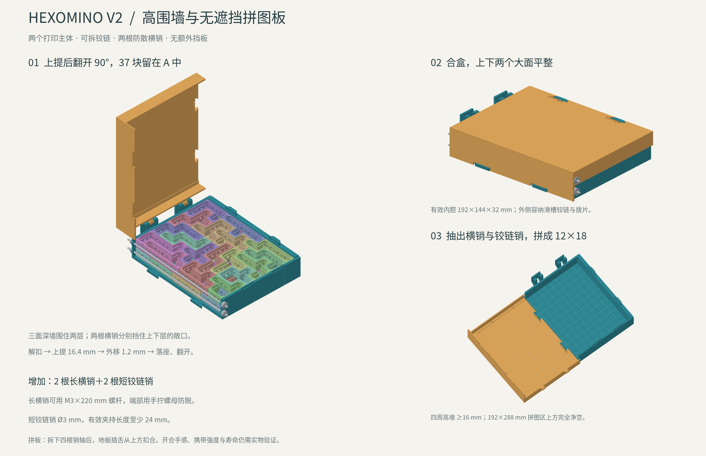
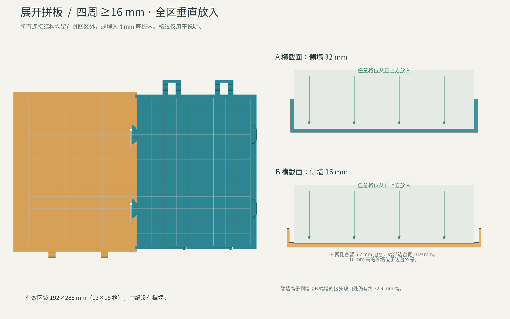

# 两片式拼图收纳盒 V2

2026-10-23。本版替代 V1，保留两个打印主体，增加可拆金属销轴。展开后四周的墙均至少一格高，12×18 格拼图区可从正上方放入任何拼块；合盒上下两个大面平整。当前为可试打设计，开合手感、满载携带和卡扣寿命需实物验证。



## 两片的形状

**A 是深底托**：4 mm 底板、两条 32 mm 高的长侧墙、一条约 33.2 mm 高的端墙，另一端用两根可抽金属横销分别挡住上下层拼块。37 个拼块全部装在 A 中，正常开盖时不用翻动装有拼块的托盘。没有增加打印挡板。

**B 是外包盖**：合盒时，两条裙边套在 A 外面；展开后翻面成为另一半拼图板，两侧围墙在底板以上高 16 mm，端墙更高。B 的侧墙厚 2.4 mm，端墙厚 2.5 mm。B 两侧各保留 5.2 mm 宽、1.2 mm 高的边台，远端边台宽 16.9 mm；高墙位于边台外缘。边台全部在有效拼图区外。

展开时，B 在水平面内转 180°，两片敞口相对。两块 4 mm 底板齐平，A 的宽头插舌从上方压入 B 的插槽，由底板内的弹片止退。有效区域为 192×288 mm，中央没有挡墙。接缝偏离格线 3.4 mm，留 0.2 mm 接缝；这不改变拼图格距。



整个有效区域的底板以上没有内伸上沿、盖片、定位柱、横销或其他遮挡。拼块可以保持最终朝向，沿竖直方向放到任意位置，包括跨越中央接缝的位置。盖板外侧的铰链、边台和卡扣不会进入这一通道。格线仅用于图示，STL 底板没有刻线。

A 长侧墙的卡扣让位处局部降至约 29.6 mm；B 端墙的接头缺口处仍高约 32.9 mm。外圈最低的墙是 B 的 16 mm 长侧墙。

## 开合与转换

两组外置滑槽铰链采用先上提、再翻开的动作，给两圈高墙让路：

1. 水平放置底托，将右侧两只卡扣向外拨开。
2. 将 B 向上提约 16.4 mm，让销轴沿竖直槽到顶。
3. 向铰链外侧平移约 1.2 mm，再下落约 0.6 mm 进入槽端的承托位置。
4. 向外翻开约 90°，由外侧限位挡住。两根防散横销和两根短铰链销在正常开盖时都保留安装。

合盖按相反次序操作：将盖板转回水平，略提起退出槽端位置，向内平移后沿竖槽放下，均匀压至两处卡扣扣合。开合过程中托住盖板，不依赖销轴间隙提供固定手感。

变成拼图板时，先将两层拼块取出，再抽出两根短铰链销和两根长横销，翻面摆开 B，压合底板插舌。解除拼板连接时，拨开 B 底板中的两处弹片，再逐端轻抬分离。拼板状态无需安装金属销轴。

## 金属配件

| 配件 | 数量 | 尺寸与用途 |
| --- | --- | --- |
| 前端防散横销 | 2 | Ø3 mm、总长约 220 mm；两支承外侧间距 200 mm，两端必须有轴向防脱结构 |
| 短铰链销 | 2 | Ø3 mm、有效夹持长度至少 24 mm；可选约 30 mm 长带端部限位的销轴 |
| 长横销端部防脱件 | 每端一组 | 可用 M3 螺杆配固定螺母和手拧螺母；手拧头外径不超过 12 mm、厚度不超过 5 mm |
| 短销端部防脱件 | 每端一组 | 销头、挡圈或螺母；销头外径不超过 8 mm，避免高出闭盒上下大面 |

长横销的中心位于底板以上 8、24 mm，分别挡住两层拼块的前端开口。图中金属件仅表示安装位置，实际螺母、挡圈按所购配件调整。光杆配挡圈接触更平滑；M3 螺杆便于获得和调节长度。未经固定的光杆容易自行滑出，不应直接作为携带状态的销轴。

两根长横销改善开盖时从前端滑出的风险，短销让日常开合保持连接；满载晃动、倾斜、倒置和跌落的保持能力仍需试验。

## 尺寸与打印

| 项目 | 尺寸 |
| --- | --- |
| 合盒保证的完整矩形有效空间 | 192×144×32 mm，12×9×2 格 |
| 展开拼图有效区域 | 192×288 mm，12×18 格 |
| 两块底板厚度 | 4 mm |
| A 主侧墙厚度 | 4 mm；卡扣处局部让位 |
| A 端墙厚度 | 8 mm |
| B 主侧墙 / 端墙厚度 | 2.4 / 2.5 mm |
| A 长侧墙 / B 长侧墙高度 | 32 / 16 mm，均从底板内表面量起 |
| A 单件打印外包 | 约 219.7×161.8×41.2 mm |
| B 单件打印外包 | 约 215.4×159.9×41.2 mm |
| 合盒外包，不含金属端头 | 约 222.1×161.8×41.2 mm |
| 展开外包，含外置铰链 | 约 230.3×315.8×41.2 mm |

内腔保证的高度从 Z=4 到 36 mm；大部分中央盖内表面在 Z=37.2 mm，盖板外缘边台降到 Z=36 mm。原有拼块每面的 0.10 mm 打印间隙保持有效，不再修改拼块。全部 37 块的两层排布沿用 [原收纳方案](../packing_12x9x2.png) 和 [排布数据](../packing_12x9x2.json)：下层 19 块、上层 18 块，每层 108 格。

两件按 STL 当前姿态、底板外表面朝下打印。A 的约 219.7 mm 占床宽度接近 220 mm，切片时还需为裙边和设备边界留位置。外置铰链的斜撑约为 45°；横向销孔、侧扣台阶和 B 的铰链局部是否需要支撑，应按设备的桥接表现检查，避免支撑填满弹片缝和滑槽。

拼板插槽按每侧 0.20 mm 让位；Ø3 mm 销轴孔和滑槽宽 3.6 mm。外包裙边与 A 主体每侧间距 1.2 mm，由端部定位插舌、铰链和卡扣限制合盒晃动。先截取一组铰链、卡扣和底板接头试打，再打印两个完整主体。配合余量需要随打印机校准，参见 [Prusa 建模说明](https://help.prusa3d.com/article/modeling-with-3d-printing-in-mind_164135)。

## 验证与文件

`validation_results.json` 记录了源文件和两个 STL 的 SHA-256，以及以下检查：

- 两个 STL 都是封闭、法向一致的单一实体。
- 合盒、展开分别检查 362 个由网格顶点分段得到的截面，没有实体面积重叠。
- 267 个上提、外移、落座和旋转位置，每个检查 362 个截面，没有实体干涉。初始解扣用钩头向外平移 0.8 mm 近似。
- 截取底板以上的全部三角面，投影到 192×288 mm 拼图区，没有遮挡；检查区域距名义边界 0.001 mm，严于拼块的 0.10 mm 外缩。
- 合盒后的完整 192×144×32 mm 矩形空间无侵入。
- Ø3 mm 铰链销在滑槽的 185 个中心位置及盖板销孔内无干涉。

这些是名义尺寸下的刚体采样检查，不包含打印变形、卡扣应力、销孔磨损、满载挠曲或跌落分析。正式携带前，应完成空盒开合、接头拉脱和满载拿取试验。

文件：`hexomino_box_v2.scad` 为源码，`STL/Tray_A.stl`、`STL/Tray_B.stl` 分别打印；`view="box"`、`"open"`、`"board"` 可查看三种装配状态。重新生成：

```sh
openscad --backend=CGAL --hardwarnings --export-format=binstl -D 'part="A"' -o box/v2/STL/Tray_A.stl box/v2/hexomino_box_v2.scad
openscad --backend=CGAL --hardwarnings --export-format=binstl -D 'part="B"' -o box/v2/STL/Tray_B.stl box/v2/hexomino_box_v2.scad
python box/v2/validate_geometry.py
```

验证脚本需要 NumPy、trimesh、Shapely、SciPy。V1 文件保留用于版本追溯，不再作为本轮试打方案。
